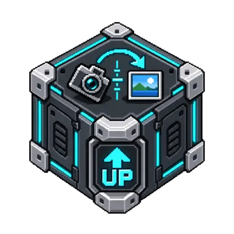

# RightWayUp

[](media/cover.png)

<!-- block-metadata:start -->
[](model.json)
[](compatibility.json)
[](LICENSE)

Verified BloxSmith versions: **1.0.9** (bundled-block tests; see [test evidence](compatibility.json)).
<!-- block-metadata:end -->


Estimate **image roll** locally using the real ORTUS RightWayUp ONNX models. Track camera-image rotation over time with confidence gating, circular smoothing and change notifications. This is not a 3D camera-pose estimator, a video transport or an image-rotation editor. Model confidence is not a guarantee that an angle is correct.

## Connect it

Send a local image path to the multi-source **`frame`** input. Camera Photo's file output is compatible. For multiple cameras, pass one JSON object per frame:

```json
{
  "path": "camera-north/frame-001.png",
  "source_id": "north",
  "frame_id": "frame-001",
  "timestamp": "2026-10-05T09:00:00.000000+00:00"
}
```

Use the actual capture timestamp, not the example date. An optional `sha256` binds the request to immutable file contents. Without it, the block processes a stable snapshot of the file when inference begins; upstream producers should use unique frame paths rather than repeatedly overwriting one file. Keep those files available until processing completes. No image URLs, base64 inputs, animation or implicit video capture.

Relative paths resolve below **Permitted image directory**. An empty setting uses the application root. Only regular, single-link files within this directory are accepted; symlinks and parent traversal are refused. Supported images: JPEG, PNG, WebP, TIFF and BMP. EXIF orientation is applied before estimating residual image roll; source files remain unchanged. Upstream's RGB conversion and letterbox preprocessing are preserved, including its handling of transparency.

For plain paths, the configured camera ID and arrival timestamp are used. JSON identifies each camera independently. IDs contain ASCII letters, digits, underscores or hyphens. A timestamp must include its timezone and cannot be more than five seconds in the future. Supply synchronized camera timestamps for meaningful freshness checks.

## Outputs and angle convention

| Port | Meaning |
| --- | --- |
| `orientation` | Source ID, frame ID, capture/observation time, confidence, acceptance, model identity, source hash and tracking state. Processing errors are recoverable JSON states on this port. |
| `change` | A `rotated` event when smoothed drift reaches the configured threshold; a `returned` event once it drops below half that threshold. |

`raw_angle_cw` is the model's clockwise content rotation in `[0,360)`. Accepted results expose it as `angle_cw`. `smoothed_angle_cw` is the circular mean of recent accepted estimates. `correction_ccw` is that same positive magnitude applied **counterclockwise** to straighten an image, not a clockwise rotation command. `delta_cw` is signed drift from the reference in `[-180,180)`. A change in scene contents can affect the estimate even if the physical camera never moves.

The calibrated model abstention threshold and your minimum confidence both apply. Rejected estimates have `accepted:false`, null accepted/corrective angles and no change event; `raw_angle_cw` remains diagnostic only. Uncertain frames clear the smoothing window. Mutually opposed estimates yield `unstable`, not an arbitrary straightening command. Other normal states are `warming`, `stable`, `drifted`, `stale` and `out_of_order`.

The first full accepted window establishes a fixed reference for each camera. Only threshold crossings produce alerts, with half-threshold recovery hysteresis to avoid repeated alerts. After the configured interval without an accepted estimate, a fresh warm-up replaces the reference. References are per Run, not durable calibration. Standard/Strict abstention is model-specific; they need not have different thresholds for every model precision.

## Execution and limits

**Active Runtime** starts a lightweight listener on Run, without loading or downloading the model. On the first frame it starts one owned ONNX process, reuses that loaded model, and schedules one inference at a time. There is at most one pending frame per source: newer arrivals replace older pending work. Sources are capped, rate-limited independently, and serviced without an unbounded block-owned image backlog. An already running frame can complete if still fresh. Obsolete queued/results are discarded according to maximum age; `dropped_frames` reports cumulative scheduler drops. The framework's upstream event queue remains outside this block's control.

**Simulation / One Shot** performs actual local inference for one image, then closes the model process. Its temporal tracker starts fresh for that activation; use Active Runtime for ongoing drift detection. No inference is triggered by cached, unchanged input attributes alone.

Default limits: 10 MiB source file, 16 megapixels, 16,384 pixels per side, 8 cameras, 1 second between inferences per camera, 10-second frame age, 5-frame smoothing and a 10-degree change threshold. Adjust these to the camera and CPU budget. The block does not configure a camera's sampling frequency. Extract video frames upstream with an explicit adapter; no framework video-stream capability is assumed or added.

Stop cancels the supervised native process and clears pending work. Linux parent-death signaling also kills the model process if its owning runtime process dies. CPU inference has a 4 GiB virtual-address-space limit; CUDA does not use that limit because GPU drivers reserve large virtual ranges. Processing and first-loading deadlines remain bounded for either device. This is process supervision, not an OS security sandbox.

Image snapshots remain in memory. Download staging is removed as soon as the initial model load completes; no temporary job directory remains while a loaded model waits for more frames. An abrupt host/OS termination during the first download can leave an incomplete `rightwayup-job-*` staging directory in node storage; it is never loaded as a model. Offline preparation avoids this window. Complete checksum-verified model files are retained intentionally.

## Model loading and prerequisites

Requirements: Linux, Python 3.10+, Pillow 10.2+, NumPy 1.26+ and ONNX Runtime 1.18+ (`onnxruntime` for CPU or a compatible `onnxruntime-gpu` installation for CUDA). The supervised process uses the same interpreter and its installed distributions, without inheriting Python environment overrides. No API key, model SDK, image upload or paid service is required.

| Tier | CPU weights | Input size | GPU weights |
| --- | --- | --- | --- |
| Nano | INT8, about 24 MB | 112 × 112 | FP16, about 46 MB |
| Fast (default) | INT8, about 24 MB | 224 × 224 | FP16, about 46 MB |
| Max | INT8, about 312 MB | 280 × 280 | FP16, about 612 MB |

CUDA must have a working ONNX CUDA provider and compatible GPU/driver libraries. The block refuses unavailable CUDA instead of silently switching the whole inference to CPU; ONNX may still execute individual unsupported operators on CPU. CPU Nano/Fast/Max are locally tested. GPU execution is implemented but is **not hardware-qualified** by the CPU-only test environment.

Weights and calibrated thresholds are pinned to ORTUS RightWayUp **1.0.0**, Hugging Face revision `959453f1f42a79a35221c19003900cef0bef8bac`. `model_artifacts.json` records immutable URLs, exact byte counts and SHA-256 hashes. Only the selected tier/precision downloads, on the first frame and only if permitted. Verified model bytes are passed directly to ONNX Runtime. A corrupt cache is refused, never silently replaced. The cache is under the public `get_block_storage_dir()` node directory in `rightwayup-cache/`, preserved across Runs.

For offline or live-stream preparation, provision the intended node storage explicitly:

```sh
python setup_model.py --storage BLOCK_STORAGE_DIRECTORY --tier fast --device cpu
```

Then disable **Download missing weights**. The helper only prepares the cache; it never edits a blueprint. Prewarming avoids stale first-frame results during a long initial download. CPU/GPU weights have independent checksums; never rename one as the other.

## UI and tests

The modal and inspector use the same settings and draft semantics: Apply saves, Cancel discards. Essential model/source controls are visible; temporal tuning and resource limits are under Advanced settings. Decimal confidence and angle thresholds are accepted. The card displays the selected tier/device. The package owns English/French catalogs, ES-module assets and version-scoped CSS.

Owned tests cover all three real CPU models, reference decoding/preprocessing, silence-like ambiguous imagery, circular wraparound, drift hysteresis, timestamp/source isolation, freshness, newest-pending replacement, rate limiting, malformed files, offline/corrupt cache, cancellation, both framework runtimes and bundled/managed/linked installation, plus browser UI geometry/drafts/persistence. Synthetic images avoid user footage. Deterministic tracking tests supplement real inference; they are not an accuracy benchmark for camera scenes. Model fixtures remain outside Git. Set `RIGHTWAYUP_TEST_CACHE` to a prepared `rightwayup-cache` containing all three CPU models when running the suites with the private framework harness.

## Upstream and license

Block code: Apache-2.0. ORTUS model weights are downloaded separately, not redistributed here. Preprocessing and angle/confidence decoding follow the upstream reference at code revision `822c09128e5f2b345b8da4c6b112ea66965a8fc3`; see [NOTICE](NOTICE) for attribution and upstream notices.

References: [ORTUS RightWayUp](https://github.com/ortusaitech/rightwayup), [model card and weights](https://huggingface.co/ortusai/rightwayup). This integration is not an official ORTUS product.
